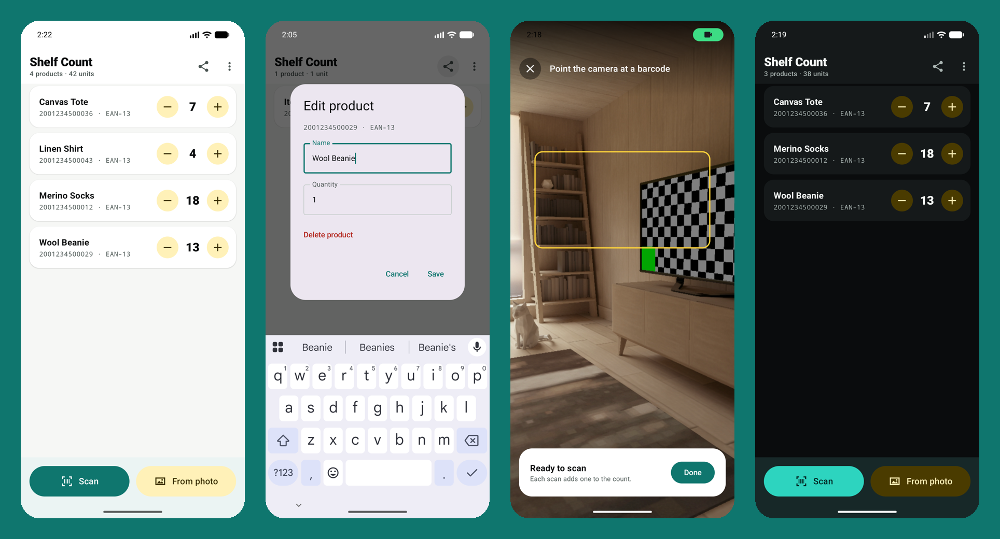

# Shelf Count

A small, offline barcode stock counter for Android. Scan products with the camera (or from a photo), count them, fix a number by hand, and share the count as a CSV file.

Built as an open-source demo of modern Android work: Kotlin, Jetpack Compose, Room, CameraX and on-device ML Kit barcode reading, with unit tests and on-device database tests.



## What it does

- **Scan with the camera.** Each scan of a barcode adds one. The same code is counted once per 1.5 seconds, so holding the phone still does not run the count up.
- **Scan from a photo.** Pick a picture from the gallery through Android's photo picker (no storage permission needed). A product scanned for the first time asks for its name.
- **Count by hand.** Plus and minus buttons on every row; tap a row to rename it, set the quantity or delete it (with Undo).
- **Export.** Shares a CSV file (barcode, name, quantity, format, last counted) through the normal Android share sheet: email, Drive, chat apps.
- **Works offline.** Everything is stored on the phone in a local database. No account, no server, nothing uploaded.
- **Light and dark theme**, portrait and landscape.

Reads EAN-13, EAN-8, UPC-A, UPC-E, Code 128, Code 39 and QR codes.

## Built with

| Area | Library |
|---|---|
| UI | Jetpack Compose, Material 3 |
| State | ViewModel, Kotlin coroutines and Flow |
| Storage | Room (SQLite) |
| Camera | CameraX (Preview + ImageAnalysis) |
| Barcode reading | Google ML Kit barcode scanning (bundled model, runs on the device) |
| Sharing | FileProvider + Android share sheet |

Kotlin 2.4, Android Gradle Plugin 9.5, compileSdk/targetSdk 37 (Android 17), minSdk 26 (Android 8.0).

## Details worth a look

- **Counting is one database transaction** (`ItemDao.countScan`): find the barcode, add one or create the row, so two quick scans can never lose a count.
- **The list stays put while you count.** It is sorted by name, not by last change, so rows do not jump while you tap plus and minus.
- **CSV export is safe to open in a spreadsheet.** Cells are quoted correctly, and names that start with `=`, `+`, `-` or `@` are written as text, so a product name cannot run as a spreadsheet formula (CSV injection).
- **Camera permission is handled in full**: asks once, explains why if refused, and offers app settings if refused again. The "From photo" path works with no camera permission at all.
- **Release build tested on a device.** R8 full mode strips the reflective constructors ML Kit needs, which silently breaks scanning in release builds only; `app/proguard-rules.pro` keeps them.

## Tests

```bash
./gradlew testDebugUnitTest            # CSV building, CSV injection, EAN-13 check digits, summary text
./gradlew connectedDebugAndroidTest    # Room DAO on a device or emulator: counting, renaming, sorting, delete
./gradlew lintDebug
```

`tools/make_labels.py` makes EAN-13 test labels (codes in the in-store `20` range, so they never match real products). Push them to an emulator and scan them with "From photo".

## Build

Open the project in Android Studio, or from the command line:

```bash
./gradlew assembleDebug
```

## License

MIT, see [LICENSE](LICENSE).
